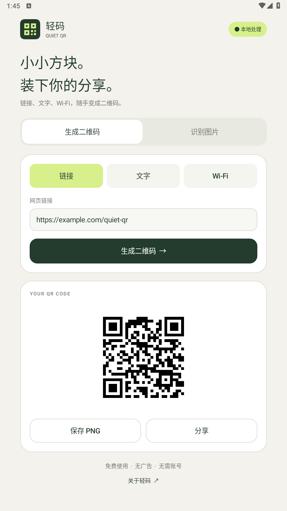
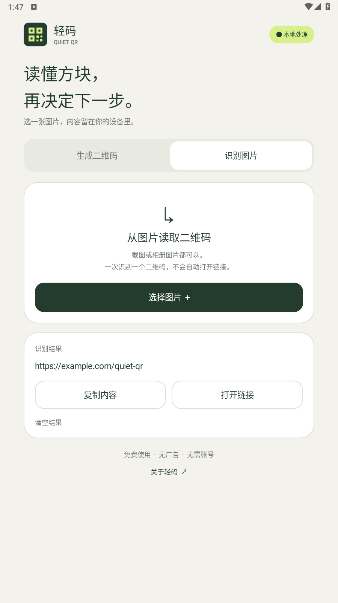

# 轻码 / Quiet QR

一个免费、离线、无需账号的 Android 二维码工具。首个可安装版本：0.1.0-preview。

## 功能

- 生成网址、文本、Wi-Fi 二维码。
- 从系统文件选择器选择图片，识别其中一个二维码。
- 导出 PNG，通过 Android 系统分享面板分享。
- 复制识别结果；打开 HTTP/HTTPS 链接前明确确认。
- 无广告、无统计 SDK，不申请网络、相机或广泛存储权限。

目前不支持实时相机扫码、多码识别、云同步或历史记录。二维码和 Wi-Fi 密码应由用户自行决定是否分享。

## 实际界面

| 生成 | 识别 |
| --- | --- |
|  |  |

## 安装

本地交付文件在仓库根目录 `dist/quiet-qr-0.1.0-preview.apk`，支持 Android 8.0（API 26）及以上。将 APK 传到 Android 手机安装；按系统提示允许相应文件来源安装应用。

这是开发证书签名的预览包，尚未发布 Google Play。正式发布需确定所属账号、应用 ID 与独立生产签名；预览签名不能视作生产发行密钥。

## 从源码构建

当前已验证环境：Windows、Python 3、项目内便携 JDK 17 / Android SDK。首次下载需要网络和数百 MB 磁盘空间，不修改系统 Java 环境。

在仓库根目录运行：

```powershell
python tools/setup_toolchain.py
python tools/test_android.py
python tools/build_android.py
```

工具链固定版本并校验下载文件摘要，存储于忽略提交的 `.toolchain/`。构建脚本自动生成本机开发签名，不能保证不同机器生成的 APK 字节一致。

也可用 Android Studio 打开本目录。Gradle 项目使用 AGP 8.10.1、Gradle 8.11.1、JDK 17、compile/target SDK 36；当前未附 Gradle wrapper，此路径尚未在本机验收。已验收的是上述 Python 调用 Android 官方构建工具的路径。

## 工程结构

- `MainActivity`：原生界面、系统文件选择器、导出与生命周期处理。
- `QrContent`：内容校验与 Wi-Fi 字符转义。
- `QrCodec`：ZXing 编解码。
- `QrImageProvider`：向用户选择的接收应用授予只读图片访问。
- `tests/QrCoreTest.java`：核心行为检查。

[验收记录](docs/verification.md) · [隐私说明](docs/privacy.md) · [版本记录](CHANGELOG.md) · [第三方说明](../../THIRD_PARTY_NOTICES.md)

源码使用 [MIT 许可证](../../LICENSE)，ZXing 按其 Apache 2.0 许可证使用。
